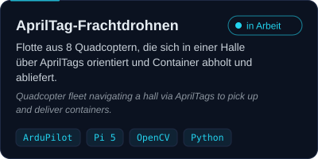
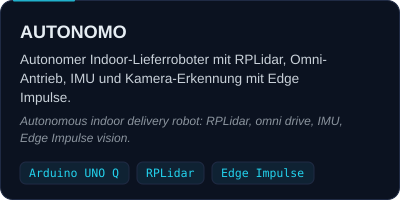
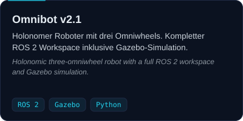
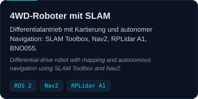
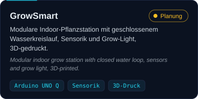

  

  

## Über mich · About me

<table>
<tr>
<td width="50%" valign="top">
<b>DE</b>
<ul>
<li>Ich baue autonome Roboter – von der Idee über CAD und eigene Platinen bis zum fahrenden System.</li>
<li>Gerade: eine Drohnenflotte, die sich mit AprilTags in einer Halle orientiert und Fracht transportiert.</li>
<li>Zuhause in ROS 2, Python und C++, auf ESP32, Arduino und Raspberry Pi.</li>
<li>Nächstes Ziel: selbst bei Robotik-Wettbewerben antreten.</li>
</ul>
</td>
<td width="50%" valign="top">
<b>EN</b>
<ul>
<li>I build autonomous robots – from idea and CAD to custom PCBs and a moving system.</li>
<li>Right now: a drone fleet that navigates a hall using AprilTags and carries cargo.</li>
<li>At home in ROS 2, Python and C++, on ESP32, Arduino and Raspberry Pi.</li>
<li>Next goal: competing in robotics competitions myself.</li>
</ul>
</td>
</tr>
</table>

## Technik · Tech

  

## Projekte · Projects

<!-- Für öffentliche Repos:  in <a href="https://github.com/MartinH79/REPO"> … </a> einschließen -->
<table>
<tr>
<td></td>
<td></td>
</tr>
<tr>
<td></td>
<td></td>
</tr>
<tr>
<td colspan="2" align="center"></td>
</tr>
</table>

## Aktivität · Activity

  <picture>
    <source media="(prefers-color-scheme: dark)" srcset="https://raw.githubusercontent.com/MartinH79/martinh79/output/snake-dark.svg" />
    <source media="(prefers-color-scheme: light)" srcset="https://raw.githubusercontent.com/MartinH79/martinh79/output/snake-light.svg" />
    
  </picture>

Gebaut mit eigenen SVGs – der Tag im Banner ist echt: tag36h11, ID 42.

